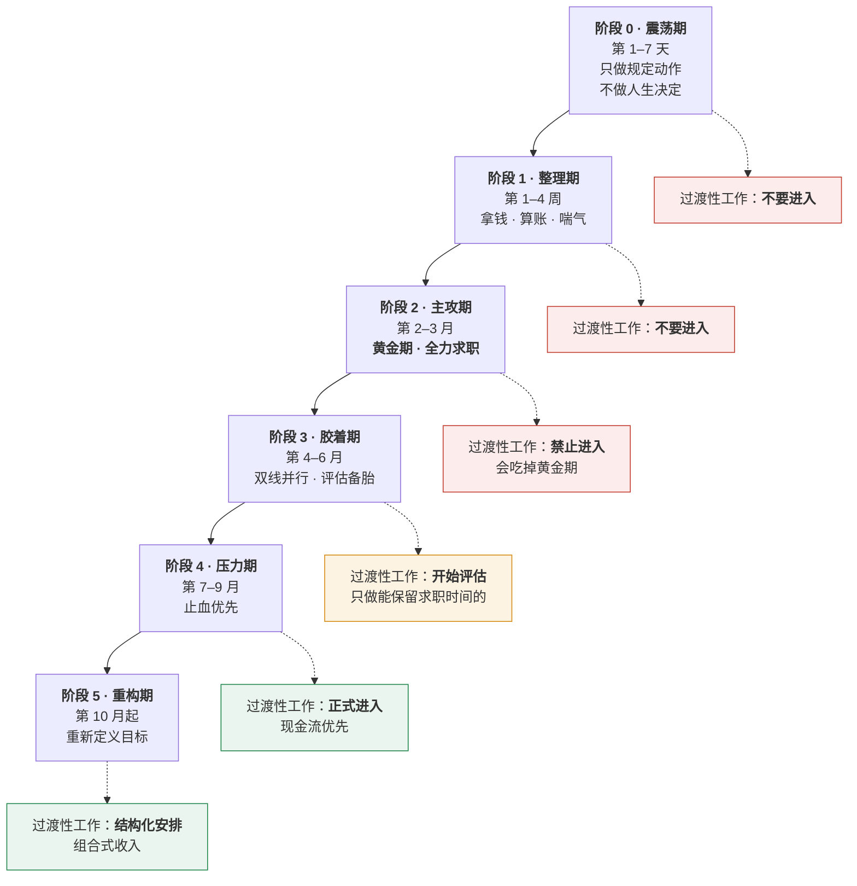
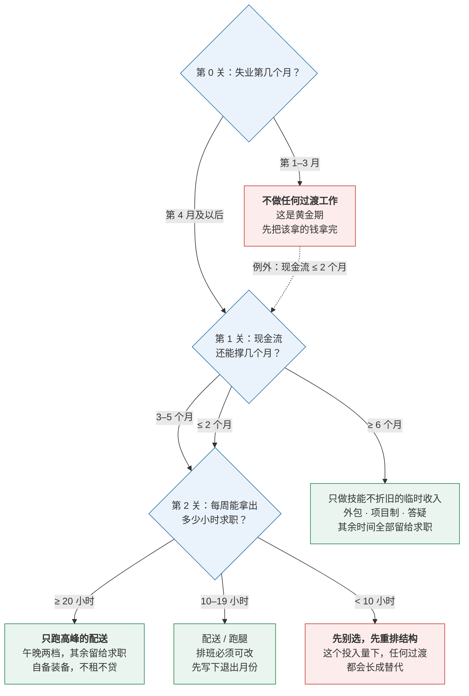

# 失业时间轴：从第一天到第三百天，以及外卖保安在第几个月

## 1. 三十秒自检

- [ ] 你不知道失业第几个月该做什么，现在基本在凭感觉走
- [ ] 你在考虑送外卖、跑网约车、做值守，但不确定现在做是不是太早
- [ ] 你已经开始一份过渡性工作，但说不清打算什么时候退出
- [ ] 你担心这段经历写进简历会减分，正在犹豫要不要写
- [ ] 你感觉自己"找了一段时间了"，但从没算过具体多少天

打勾 ≥2 个，往下读。**这一章只解决一件事：把"我还要找多久"这个模糊的焦虑，换成一张有时间刻度的地图。**

---

## 2. 结论先行

**失业不是一种状态，是一条有刻度的轴。第 1 个月和第 6 个月该做的事完全不同。用第 6 个月的打法打第 1 个月，会白白浪费掉整段黄金期。**

先给三个判断：

| 问题 | 答案 |
|---|---|
| **什么时候全力求职？** | 第 2~3 个月是黄金期。这段时间**绝不能**被过渡性工作占用 |
| **什么时候开始过渡性工作？** | 最早第 4 个月评估，第 7 个月还没着落就必须止血 |
| **外卖 / 网约车 / 保安排在第几月？** | **外卖第 4~9 月，网约车第 7~9 月，值守类（门岗 / 保安）第 10 月之后** |

**最后一条排序不是按收入高低排的，是按"它吃掉你多少求职能力"倒着排的。** 这是本章最重要的一句话，下面会讲清楚。

### 失业时间轴总图



### 六个阶段各自的任务

| 阶段 | 时间窗 | 这一阶段的唯一任务 | 明确不该做的事 |
|---|---|---|---|
| **0 震荡期** | 第 1–7 天 | 完成 [被通知当天](01-被通知当天.md) 的动作清单 | 不答应 offer、不签协议、不做不可逆决定 |
| **1 整理期** | 第 1–4 周 | 拿完该拿的钱，算出[能撑几个月](10-现金流管理.md)，办[社保接续](05-社保公积金.md) | 不海投简历；不必急着告诉所有人 |
| **2 主攻期** | 第 2–3 月 | **全力求职**。这是简历含金量最高的窗口 | **不碰任何过渡性工作** |
| **3 胶着期** | 第 4–6 月 | 双线并行。调整求职策略，同时评估保底选项 | 不恐慌性降薪（见[降薪与转行](12-降薪与转行.md)） |
| **4 压力期** | 第 7–9 月 | **止血优先**。现金流比理想重要 | 不拖。拖到现金流见底，选择权会全部丧失 |
| **5 重构期** | 第 10 月起 | 重新定义目标：组合收入 / 转行 / 长期过渡 | 不假装自己还在"正常找工作" |

### 为什么第 2~3 个月是黄金期

两个原因，都很实在：

1. **那时的空窗还不显眼。** 用人单位对 1–3 个月的 gap 普遍不追问，超过 6 个月解释成本会明显上升（详见 [重启求职](11-重启求职.md)）
2. **你的状态是这段时间最好的。** 技能还热、表达还顺、行业判断还在。这个状态会随空窗拉长持续折旧

**这段时间是你的固定资产，不是可以慢慢花的存款。** 拿它去换一个月的外卖收入，是一笔极差的交易。

### 决策树：输入两个数字，直接出答案

上面的时间轴回答的是"什么时候该做什么"。如果你现在就要一个结论，走这张图 —— 只需要两个数：**现金流还能撑几个月**、**每周能拿出多少小时求职**。



#### 这张图最反直觉的一点：第一关问的不是钱

很多人失业第 2 个月就去送外卖，**不是因为缺钱** —— 现金流还剩八个月。真正的原因是焦虑需要一个出口，而"在流动、在做事"这件事有很强的镇定作用。

它的价格是：你用整段黄金期，换了一个心理安慰。

所以这张树把**月数**放在第一关，把**钱**放在第二关。顺序不能调换 —— 一旦先看钱，几乎所有人都会高估自己的紧迫程度。

#### 第二关不看能挣多少，看还能撑多久

现金流 ≥6 个月的人去做配送，本质上是把自己的时间用最低的单价卖出去。这类人的正确选项是输出①：**找一份技能不折旧的临时收入**。它钱未必更多，但它不断你的技术，写在简历上也不减分（详见 3.4）。

#### 第三关才轮到时间和体力

它决定的不是"做不做"，是"做哪种形态"。每周 20 小时和每周 10 小时对应的正确选项完全不同 —— **这个数字你必须自己算，不要估。** 估出来的结果几乎总是偏乐观。

#### 两个 STOP 的含义

| STOP | 触发条件 | 它真正想说的是 |
|---|---|---|
| **STOP1** | 还在第 1–3 月 | 唯一的例外是现金流 ≤2 个月。除此之外，任何"先干着再说"都是在提前花掉黄金期 |
| **STOP2** | 每周求职投入 <10 小时 | 问题不在选哪个工作，在于你的时间已经被别的东西占满了。这时换任何一份过渡工作都不会改善处境，只会把它固定下来 |

#### 走完之后：把结论写成三行

图给你的是方向，不是承诺。走完立刻抄下面这段填掉 —— **没有落到纸上的决策，通常在一周内就会被推翻**：

```
我今天是失业第 ____ 个月 → 落在 STOP□ / 输出□
现金流还能撑 ____ 个月，每周能拿出 ____ 小时求职
据此，我这一阶段的安排是：________________
如果两周后 ____ 没有改善，我改为：________________
```

最后一行是这套方法的保险丝。**它把"什么时候该换打法"提前写死了，免得你在温水里靠感觉做决定。**

---

## 3. 现在就做

| 时间窗 | 动作 |
|---|---|
| **今天** | 在日历上标出失业的**第 1 天**，算出今天是第几天。写下来——模糊的焦虑来源于没有刻度 |
| **今天** | 对照六阶段表确认自己在哪一阶段。**如果你正在第 2–3 月却已经在做过渡性工作，今天就去调整安排** |
| **今天** | 走一遍上面的决策树。**只填两个数**：现金流还能撑几个月、每周能拿出多少小时求职。**每周小时数要按上周实际发生的填，不要填你的计划值** |
| **本周** | 重算 [能撑几个月](10-现金流管理.md)，标出你的**警戒点**（剩 6 个月）和**决策点**（剩 3 个月） |
| **本周** | 若准备进入过渡性工作：先用下面的六个变量打分排序，**选完再决定**，不要先看哪个钱多 |
| **本月** | 写下本节末尾那三条线，贴在每天能看到的地方 |

### 3.1 选型标准：唯一重要的是"求职留存率"

大多数人选过渡工作只看一个指标：**一个月能挣多少。**

这个指标是错的。正确的指标是：

> **这份工作每天还给你留下多少个小时的有效求职能力？**

我们叫它**求职留存率**，由六个变量构成：

| # | 变量 | 怎么判断 |
|---|---|---|
| 1 | **可退出性** | 今天下午三点想收工，能不能收 |
| 2 | **固定成本** | 不干活的那天，你亏不亏钱 |
| 3 | **时间完整度** | 能不能留出连续 2 小时刷题 / 改简历 |
| 4 | **体力消耗** | 收工后还有没有脑力做技术题 |
| 5 | **面试可请假性** | 明天上午有面试，能不能去 |
| 6 | **技能折旧** | 干三个月，技术能力保住了还是在流失 |

**把这六个变量打完分，答案自己会出来——它跟单价高低几乎没关系。**

### 3.2 三类常见工作的对比

> 以下为**经验性描述与结构分析，不是收入数据**。收入在不同城市、平台、时段差异极大，
> 请向当地从业者自行核实，不要用本节的结构判断替代实地打听。

| 维度 | 送外卖 / 跑腿 | 网约车 / 代驾 | 值守类（门岗 / 保安） |
|---|---|---|---|
| **可退出性** | ⭐⭐⭐⭐⭐ 随时收工 | ⭐⭐ 有成本就有压力 | ⭐ 排班锁死 |
| **固定成本** | ⭐⭐⭐⭐ 极低 | ⭐ 租金 / 能耗 / 抽成很重 | ⭐⭐⭐⭐ 几乎为零 |
| **时间完整度** | ⭐⭐⭐ 可自选时段 | ⭐⭐ 易被拉长 | ⭐ 整段被占用 |
| **体力消耗** | ⭐ 大 | ⭐⭐⭐ 中（久坐） | ⭐⭐⭐⭐ 小 |
| **面试可请假** | ⭐⭐⭐⭐ 容易 | ⭐⭐⭐ 一般 | ⭐ 难，需换班 |
| **技能折旧** | ⭐⭐ 会停摆 | ⭐⭐ 会停摆 | ⭐ 会停摆 |
| **建议阶段** | **阶段 3 末 ~ 阶段 4**<br/>第 4–9 月 | **阶段 4**<br/>第 7–9 月 | **阶段 5**<br/>第 10 月后 |

### 3.3 逐个说清楚

**送外卖 / 跑腿 —— 过渡形态里最优的一种**

它最大的价值不是钱，是**可退出性**。你今天下午想收工去面试，就能收工。

能立刻用的做法：

- **只跑两个高峰**：午间 11:00–13:00、晚间 17:00–19:30。其余时间全部留给求职
- **把高峰之外的时段视作"已售出"**，不要因为今天单多就加跑
- 接单前确认平台是否提供职业伤害保障，**不要默认自己有保障**，这一步别跳过
- 真实成本要算全：车辆（租 / 购 / 充电）、装备、天气与交通风险

**适合谁**：现金流能撑 3–6 个月，但想延长跑道、同时保住求职节奏的人。

**网约车 / 代驾 —— 最容易被固定成本绑架**

它的陷阱不在收入，在**成本结构**。一旦你每天睁眼就欠着租金和能耗，**你会主动把工时拉到最长**——而那正是求职能力归零的过程。

进去之前必须算的一笔账：

```
每小时净收入 =（当日流水 − 平台抽成 − 能耗 − 车辆成本 ÷ 预计工作天数）÷ 当日总工时
```

**注意分母是"总工时"，不是"接单时长"。** 很多人只算接单时间，得出一个虚高的时薪，然后发现实际每天耗在车上是十小时以上。

**只有一种人可以碰**：现金流确实紧，且**你有把握把工时卡死**。如果你属于"开都开了，再跑一会儿"那种人，别碰。

算真实时薪可以用这个工具：[真实时薪 / Offer 对比器](../../tools/real-hourly-wage/index.html)

**值守类（门岗 / 保安）—— 最后的止血手段，不是过渡**

它的问题最反直觉：**工作强度最低，但对你的杀伤力最大。**

因为它通常是整班制（常见 8–12 小时），把你白天的时间**完整地拿走**。结果是你拿到最少的钱，却失去了最多的东西：连续的学习时间、随时去面试的自由度，以及"我还在找工作"这个日常心理身份。

它最容易造成的结果是**温水效应**——不是它太好，是它太稳定，稳定到你某天发现自己已经待了八个月。

**判断线**：只接受**每周能保证至少两个完整白天用于求职**的排班。做不到就不要接。

### 3.4 一个容易忽略的选项：先看老本行

在考虑外卖之前，有一类过渡往往更优：**技能不折旧的临时收入**。

- 短期技术外包 / 项目制合同
- 线上答疑、兼职讲师、课程辅导
- 老同事的小项目救急

它的收入未必更高，但**它不断你的技能，而且写在简历上不减分，甚至可能加分**。

⚠️ **但有一个不能跳过的动作**：接任何活之前，先查劳动合同里的**竞业限制与兼职条款**。违反它可能影响你下一份工作入职，这是本节最严重的一个坑。

### 3.5 什么时候必须退出

**没有退出时间的过渡，就不叫过渡。**

进入之前先写下三条线（复制使用）：

```
进入条件：______________（例：现金流剩 4 个月，且连续 6 周无面试）
退出时间：______________（例：做到第 10 个月，无论结果如何）
每周求职保底：__________（例：每周 15 小时，且不少于 3 次投递 + 1 次面试）
```

**如果某个安排让你完不成第三条线，说明它已经不是过渡，是替代。**

---

## 4. 可直接抄的话术 / 模板

### 4.1 简历上怎么写这段经历

**原则：如实写，但把它写成一段有意图的时间，而不是一段空白。**

版本 A —— 写进简历经历栏（适合 freelance / 外包 / 项目制）：

```
2025.03 – 2025.08    自由职业 / 项目制技术工作
 · 承接后端开发外包 3 项，独立完成从需求到上线
 · 期间保持技术输出，完成 XX 认证 / 维护开源项目 XX
```

版本 B —— 如果做的是配送 / 网约车这类，**不必写进经历栏**。
简历允许有时间空档，面试官问到时答得上来即可（见 4.2）。

> ⚠️ **不要在简历上撒谎**，把过渡期写成"在某公司任职"。背景调查会查社保记录，
> 很容易被识破，而这一个谎言会连带否定你其他所有内容的可信度。

### 4.2 面试官问"这段时间你在做什么"

> 「这段时间我在集中补技术：系统性地刷了算法题、重构了一个个人项目，也在做一些短期的技术外包保持手感。
> 同时我坦诚一点——中间有两三个月我在跑网约车维持现金流。这段时间也让我把学习目标想清楚了，
> 所以现在我找的是能长期投入的方向，这也是我今天坐在这里的原因。」

要点三条：

1. **先说你学到的，再说过渡工作**，顺序不能反
2. **坦然说，不辩解**。面试官介意的不是你送过外卖，是你有没有在逃避
3. **立刻转回"我为什么适合这个岗位"**，不要停留在解释过去

### 4.3 面试官追问"你是暂时找不到工作吗"

> 「准确说是我在挑方向。上一家公司让我看清了自己想深耕的领域，这段时间我把技术栈补齐了。
> 倒是现金流上确实有压力，所以中间接过短期项目——这件事本身也说明我能对自己的处境负责。」

### 4.4 怎么跟家人说

> 「我现在的计划是这样的：前三个月全力找同方向的工作，这是成功概率最高的窗口。
> 如果到第四个月还没定下来，我会同时做一份能随时停下来的兼职来补现金流，不会干等着。
> 我能撑到几月我心里有数，不用你们担心钱。」

要点：给出**计划和时间点**，而不是情绪。家人焦虑的来源是"不知道你打算怎么办"，不是"你失业了"。

### 4.5 开始前的自检清单（复制使用）

```
□ 已确认自己在阶段 3 之后（不是卡在第 2–3 月的黄金期里）
□ 已重算现金流，标出警戒点与决策点
□ 已用六个变量给候选工作打分，不是只看收入
□ 已确认不会违反竞业限制 / 兼职条款
□ 已写下退出时间
□ 已写下每周求职保底（小时数 + 投递次数）
□ 已确认这份工作允许我在工作日去面试
□ 已告诉一位家人或朋友，让他到时候提醒我退出
```

最后一条听起来多余，**但它是对抗温水效应最有效的一招**。

---

## 5. 五个常见错误

1. **第 2 个月就去跑外卖**
   → 后果：吃掉黄金求职期。等到第 6 个月想认真找时，简历上的 gap 已经变得很难解释
   → 正确做法：前三个月精力全部投给求职；过渡性工作最早第 4 个月才评估

2. **先选钱多的那个**
   → 后果：往往就是固定成本最高的那个（比如租车跑网约车）。一旦背上日租，工时必然失控
   → 正确做法：按"求职留存率"排序，把可退出性放在第一位

3. **没设退出时间**
   → 后果：温水效应。值守类尤其危险，因为它足够稳定，稳定到让你不再着急
   → 正确做法：进入之前就写下退出月份，并告诉一个人让他到时候提醒你

4. **在简历上对这段经历撒谎**
   → 后果：背调查社保记录即可识破。一旦被发现，其他所有内容的可信度一起归零
   → 正确做法：如实说 + 先说学到什么 + 立刻转回岗位匹配度（见 4.2、4.3）

5. **接活前没查竞业与兼职条款**
   → 后果：这是本节最严重的一条——违反竞业可能影响你下一份工作入职，甚至产生赔偿责任
   → 正确做法：接任何活之前，先翻一遍劳动合同里的竞业限制与兼职条款，不确定就先别接

---

## 6. 真实案例（脱敏）

**背景**：某后端工程师，32 岁，在某中型互联网公司工作 6 年后被裁。补偿到账后现金流约可撑 9 个月。

**做对了什么**：他把失业第一天标在日历上，并给自己定了一条规则——**前三个月不做任何兼职**。第 2 个月投出的简历里有 11 家给了面试，这是他整段失业期回应率最高的窗口。

**做错了什么**：第 4 个月起面试明显变少，他开始跑网约车补贴现金流。他选了租车而不是用自家车，理由是"租的车更适合接单"。结果每天一睁眼就欠着租金，**他开始主动跑到晚上十一点**，求职时间从每天五小时掉到不足一小时。

**关键的转折**：第 7 个月他意识到自己在"用最贵的方式省钱"——每天十小时换来的流水，扣掉租金和能耗后净时薪并不高，代价却是彻底失去求职节奏。他退了车，改成只跑午晚两个高峰的配送。

**结果**：第 9 个月拿到 offer，薪资比原岗位略低但方向更好。回头看，他觉得自己真正做对的只有一件事——**前三个月没有急着去找钱**。

**如果重来**：第 4 个月就用"求职留存率"给选项打分，而不是先看收入。这一步能省下三个月。

> 这个案例说明的是"选择的结构"比"选择本身"重要，**不是"这样做一定能成功"**。

---

## 7. 延伸与依据

- 时间轴的起点：[被通知当天：24 小时动作清单](01-被通知当天.md)
- 现金流档位决定了你在哪一阶段：[现金流管理](10-现金流管理.md)
- gap 期的简历写法与面试状态恢复：[重启求职](11-重启求职.md)
- 什么情况下接受降薪：[降薪与转行](12-降薪与转行.md)
- 过渡期间社保不能断：[社保 / 公积金 / 医保](05-社保公积金.md)
- 失业期的心理状态管理：[心理：失业期的自我管理](13-心理.md)
- 算真实时薪（过渡工作同样适用）：[真实时薪 / Offer 对比器](../../tools/real-hourly-wage/index.html)

> 本章关于各类过渡工作的描述为**经验性结构分析，不是收入统计数据**。
> 收入、成本与保障在不同城市、平台之间差异极大，请以当地实际情况为准。

---

## 8. 免责

本章不构成职业规划或投资理财建议，具体处境请结合自身情况判断。详见 [免责声明](../../DISCLAIMER.md)。
